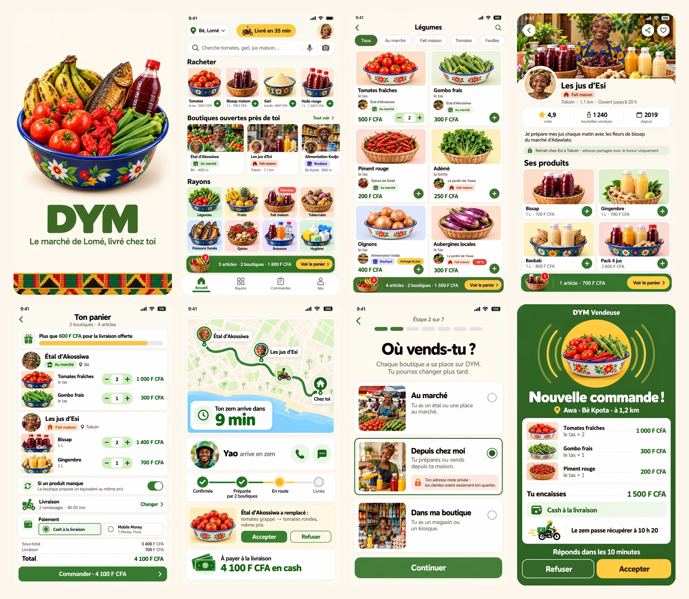

# DYM — Direction de design

> **Statut : validée le 2026-10-01.** Décision : [0009](../architecture/decisions/0009-design-direction.md).
> Tokens : [`tokens/dym.tokens.json`](tokens/dym.tokens.json) · Écrans : [`screens/`](screens/).

## La promesse visuelle

> **« Le marché de Lomé, livré chez toi. »**

L'ergonomie d'une app de courses de niveau mondial (Blinkit, Zepto, Instacart), habillée par les
matières du marché ouest-africain, avec la **boutique** comme unité centrale : celle de l'étal au
marché, celle de la vendeuse qui prépare depuis chez elle, celle de l'épicerie de quartier.

## La trajectoire d'africanisation (règle de conception)

On part d'un standard universel irréprochable, puis on ajoute des couches locales. Une couche ne doit
jamais retirer de vitesse ni de lisibilité.

| Niveau | Contenu | Statut |
|---|---|---|
| 0 · Base universelle | Recherche d'abord, délai visible, « Racheter » en tête, ajout en un tap avec stepper, mini-panier flottant, jauge de livraison offerte, remplacements transparents | **Non négociable** |
| 1 · Contenu local | Produits réels, unités du marché, quartiers, F CFA, cash et Mobile Money, boutiques nommées | **Obligatoire** |
| 2 · Matières locales | Palette du marché, produits photographiés dans des contenants du marché (bassine émaillée, calebasse, panier tressé, sachet kraft) | **Identité de DYM** |
| 3 · Signature | Dosée : 3 touches maximum par écran, voir ci-dessous | **Dosé** |

### Touches de signature autorisées (niveau 3)

| Touche | Où | Rôle |
|---|---|---|
| Boutiques avec badge d'origine | Accueil, rayon, panier, page boutique | Confiance : on sait de qui on achète |
| Le zem | Pastille de délai, suivi, ramassage côté vendeuse | Réalité de la livraison à Lomé |
| Le motif kente éwé | **Splash uniquement** | Signature de marque |

### Interdits

- Aucune monnaie fictive (cauris, points, jetons) : tout avantage est exprimé en **F CFA**.
- Aucun motif derrière du texte.
- Pas de puce de langues permanente : les langues locales apparaissent à l'appui sur le micro.
- Pas d'interface sombre ni de verre flouté (lisibilité en plein soleil, performances sur 2 Go de RAM).

## La boutique et ses origines

| Origine | Badge | Exemple | Mise en avant |
|---|---|---|---|
| Au marché | Vert tendre, icône d'étal | Étal d'Akossiwa · Bè | Fraîcheur, arrivage du matin |
| Fait maison | Pêche, icône de maison | Les jus d'Esi · Tokoin | Savoir-faire, histoire |
| Boutique | Indigo clair, icône de devanture | Alimentation Kodjo · Bè Kpota | Choix, horaires élargis |

Pour une boutique « Fait maison », l'app n'affiche que le **quartier** ; l'adresse exacte n'est
partagée qu'avec le livreur, au moment du ramassage.

## Système

| Élément | Règle | Token |
|---|---|---|
| Action principale | Une seule couleur : vert gombo | `color.brand.gombo` |
| Mises en avant | Jaune plantain (délai, jauges, bouton sur fond vert) | `color.accent.plantain` |
| Promotions, compteurs, alertes | Rouge piment ; badges avec texte blanc en `piment-strong` | `color.accent.piment(-strong)` |
| Fond | Crème chaud ; cartes blanches | `color.surface.*` |
| Typographie | Grotesque arrondie grasse pour titres et prix (chiffres tabulaires) ; sans-serif lisible pour le texte ; 3 tailles max par écran | `typography.*` |
| Formes | Cartes 24 px, tuiles 20 px, puces en pilule | `radius.*` |
| Cibles tactiles | 48 px minimum | `size.touch-min` |
| Contraste | AA (4,5:1) pour tout texte ; valeurs mesurées dans les tokens | — |

Typographies proposées (Nunito, Nunito Sans) : **à valider sur un Android d'entrée de gamme** avant
de figer `dym_ui`.

## Écrans validés

| # | Écran | Fichier | Parcours (`MOCKUPS.md`) |
|---|---|---|---|
| 1 | Splash | [01-splash](screens/01-splash.webp) | — |
| 2 | Accueil | [02-accueil](screens/02-accueil.webp) | 2 |
| 3 | Rayon Légumes | [03-rayon-legumes](screens/03-rayon-legumes.webp) | 2, 3 |
| 4 | Page boutique (fait maison) | [04-page-boutique](screens/04-page-boutique.webp) | 2 |
| 5 | Panier multi-boutiques | [05-panier](screens/05-panier.webp) | 4, 5 |
| 6 | Suivi | [06-suivi](screens/06-suivi.webp) | 7 |
| 7 | Vendeuse · « Où vends-tu ? » | [07-vendeuse-ou-vends-tu](screens/07-vendeuse-ou-vends-tu.webp) | 9 |
| 8 | Vendeuse · Commande reçue | [08-vendeuse-commande-recue](screens/08-vendeuse-commande-recue.webp) | 12 |

Ce sont des **rendus de concept générés par IA** (ChatGPT, gpt-image-2), pas des fichiers de
production. À reprendre lors de la construction :

- vraies photos des vendeuses et des produits (les visages générés ne sont pas constants d'un écran à l'autre) ;
- vraie carte de Lomé dans le suivi (les quartiers sont réels, leurs positions approximatives) ;
- logo DYM à dessiner (le splash n'utilise qu'un mot en typographie grasse) ;
- illustration du jus de baobab à corriger.

## Explorations écartées

Explorées le 2026-10-01 puis écartées : « Marché Vivant » illustré, « Pagne » (motifs générés),
« Voix du Marché » (personnage guide), « Lagune » (sombre, verre liquide), « Argile » (3D), « Couverture »
(éditorial), « Brut » (néo-brutalisme). Les éléments réutilisables : la grille bento d'« Argile » pour
le tableau de bord vendeuse, et le motif généré de « Pagne » comme identité par défaut d'une boutique
sans photo.
