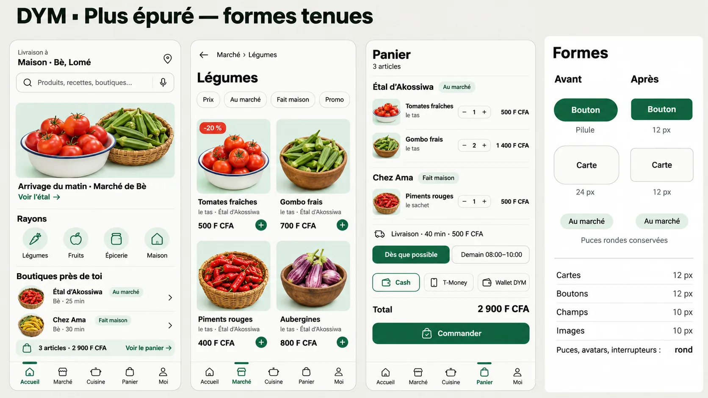
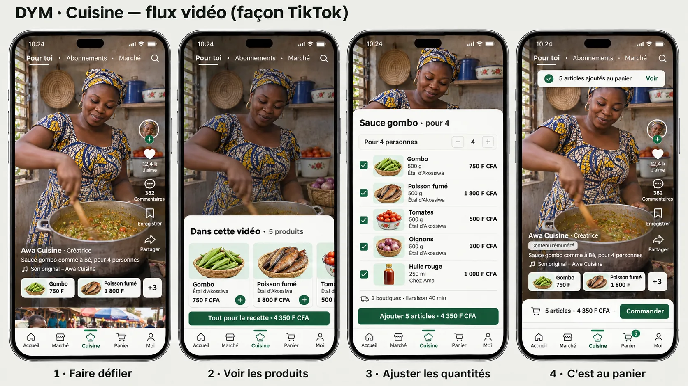
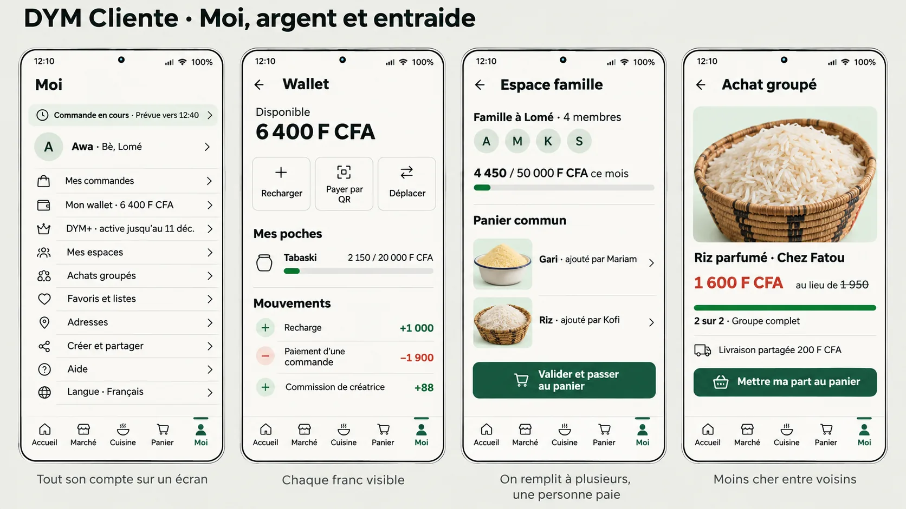
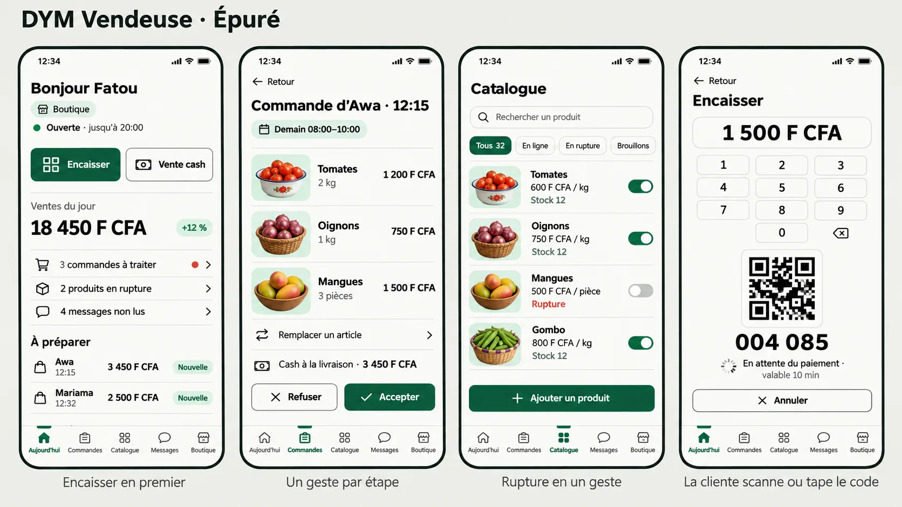
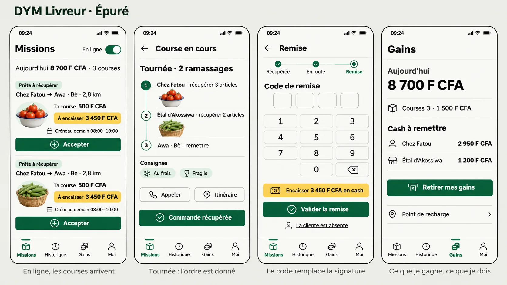
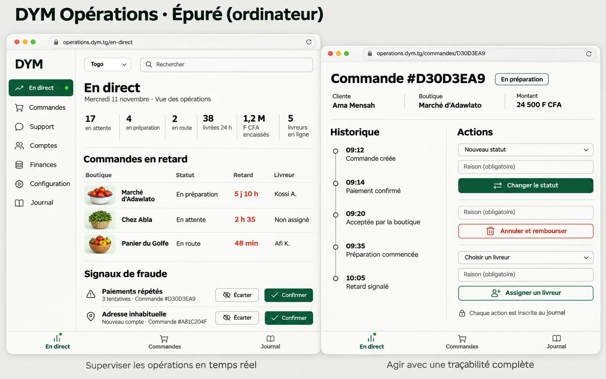
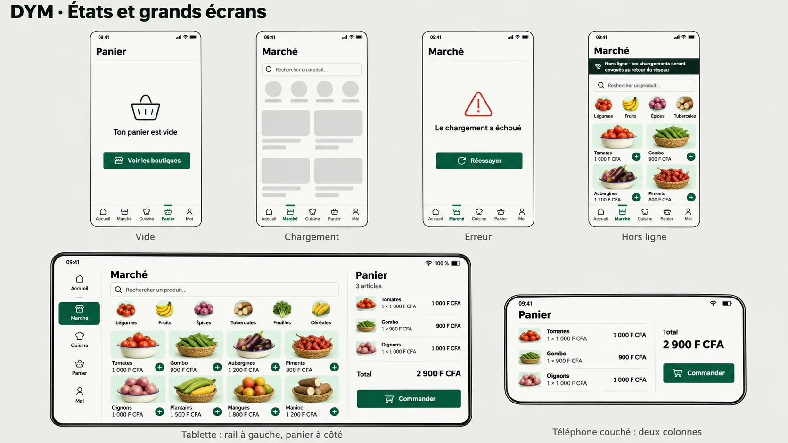
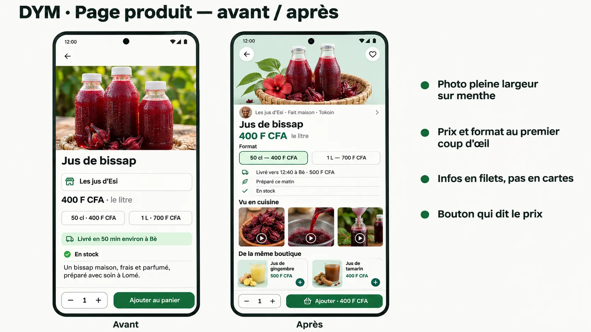
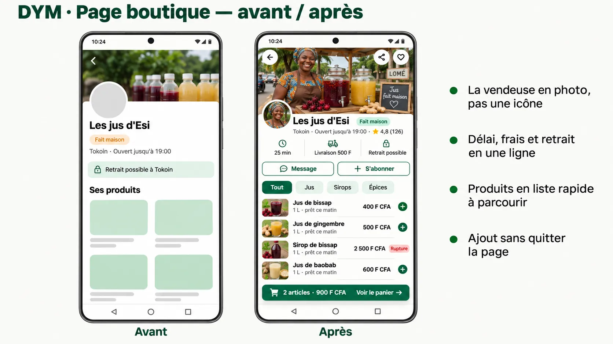

# DYM — Parcours et sitemaps (design « Épuré »)

> **Statut :** design validé par le porteur produit le 2026-11-11. Ce document décrit l'expérience
> cible des quatre apps ; il sera la référence de la spec de refonte (navigation et design system).
> Planches de référence : [`screens/epure/`](screens/epure/) (images générées pour montrer l'intention ;
> là où elles s'écartent de ce document, ce document l'emporte : par exemple les puces y sont rondes,
> elles prennent ici le rayon des boutons).
> Remplace, une fois la refonte livrée : [`DESIGN_DIRECTION.md`](DESIGN_DIRECTION.md) pour l'habillage
> et [`../product/SITEMAP.md`](../product/SITEMAP.md) pour la navigation.

## 1. Ce qui guide chaque écran

| Contrainte du terrain | Réponse de l'interface |
|---|---|
| 3G instable, données chères | Premier affichage depuis le cache ; seul l'écran visible se charge ; images légères ; une seule vidéo préchargée |
| Plein soleil | Contraste AA mesuré ; texte de 14 px minimum ; gris secondaire foncé ; aucun texte posé sur une photo chargée |
| Lire peu, parler beaucoup | Micro dans chaque recherche (langues locales à l'appui) ; icône + texte sur chaque action ; montants en gros chiffres ; vocaux dans les messages |
| Cash d'abord | Cash, Mobile Money et wallet au même niveau ; le montant à payer ou à encaisser est toujours écrit en clair |
| Une main, en mouvement | Action principale en bas, à portée de pouce ; cibles de 48 px ; un geste par étape pour la vendeuse et le livreur |
| Téléphone partagé, Android 2 Go | Sessions courtes ; rien de lourd en mémoire ; reprise exacte après une coupure |

## 2. Langage visuel

| Élément | Règle |
|---|---|
| Fond | Blanc cassé `#FAFAF7` ; peu de cartes : le contenu repose sur le fond, séparé par des filets `#E6E7E2` |
| Couleur d'action | Un seul vert profond `#145C43` : action principale, onglet actif, une carte forte au plus par écran |
| Couleurs de rôle | Menthe `#E8F2EC` derrière les produits ; tomate `#D93F33` pour promo, rupture, erreur ; soleil `#F6C343` pour le cash à encaisser et les notes |
| Texte | Encre `#16201B` ; secondaire gris foncé `#4E5852` ; 14 px minimum |
| Typographie | Inter : SemiBold pour titres et prix (chiffres tabulaires), Regular pour le texte |
| Formes | Cartes, boutons, puces et filtres : **12 px** ; champs et images : **10 px** ; ronds seulement pour avatars, interrupteurs, petits boutons « + » et indicateur d'onglet |
| Relief | Aucune ombre, aucun dégradé, aucun flou |
| Photos | Produits réels détourés sur fond menthe, dans les contenants du marché (bassine émaillée, calebasse, panier tressé) ; détourage automatique à l'envoi par la vendeuse, sinon photo carrée recadrée sur menthe |
| Origine des boutiques | Pastille de couleur : « Au marché » (vert), « Fait maison » (pêche), « Boutique » (indigo) |
| Navigation | Barre plate blanche avec filet au-dessus ; icône + libellé ; onglet actif en vert avec un petit indicateur au-dessus de l'icône |
| Mode vidéo | Seule exception sombre : barre de navigation sombre pendant la lecture plein écran |

### Planches

| Planche | Écrans |
|---|---|
|  | Cliente : accueil, rayon, panier ; formes avant et après |
|  | Cliente : flux vidéo en quatre étapes |
|  | Cliente : Moi, wallet, espace famille, achat groupé |
|  | Vendeuse : aujourd'hui, commande, catalogue, encaisser |
|  | Livreur : missions, tournée, remise, gains |
|  | Opérations : en direct, détail d'une commande (sans barre basse sur ordinateur) |
|  | États vide, chargement, erreur, hors ligne ; tablette, téléphone couché |
|  | Cliente : page produit, avant / après (direction validée le 2026-11-11 ; la photo de la vendeuse sera plus grande) |
|  | Cliente : page boutique, avant / après (direction validée le 2026-11-11 ; aucun texte dans la photo de couverture) |

## 3. Navigation

| App | Onglets |
|---|---|
| Cliente | Accueil · Marché · Cuisine · Panier · Moi |
| Vendeuse | Aujourd'hui · Commandes · Catalogue · Messages · Boutique |
| Livreur | Missions · Historique · Gains · Moi |
| Opérations (ordinateur) | En direct · Commandes · Support · Comptes · Finances · Configuration · Journal |

Sur tablette et ordinateur, la barre du bas devient un rail à gauche (décision 0012).

## 4. Sitemaps

Légende : **IA** = assisté par l'IA · **simulé** = fournisseur simulé jusqu'à la production (décision
0015) · **reporté** = hors périmètre pour l'instant.

### 4.1 DYM Cliente

- **Accueil** — ce qu'il me faut aujourd'hui
  - Bandeau « Commande en cours » (s'il y en a une) → suivi, code de remise, appeler le livreur
  - Recherche texte, micro, photo (IA) → résultats et filtres (prix, origine, boutique)
  - « Qu'est-ce qu'on mange ? » (IA) → panier composé → Modifier ou Tout ajouter
  - Racheter mes dernières courses, mes listes
  - Arrivage du matin → étal du jour
  - Boutiques près de toi (dont « À la une », signalée sponsorisée) ; stories des boutiques
- **Marché** — parcourir et choisir
  - Rayons en photos → rayon → grille de produits
  - Boutiques → page boutique : produits par catégorie, horaires, avis, écrire, partager
  - Fiche produit : unité (tas, bol, kilo), prix, stock, arrivage ; Marchander ; Ajouter ; question ; signaler
  - Promos et fin de marché
  - Achats groupés près de toi
- **Cuisine** — découvrir, puis acheter ce qu'on voit
  - Vidéos plein écran, à faire défiler : Pour toi · Abonnements · Marché
    - Produits de la vidéo → « Tout pour la recette » → quantités pour N personnes → ajouté sans quitter la vidéo
    - J'aime, commentaires, enregistrer, partager, signaler ; mention « Contenu rémunéré »
  - Recettes → portions, ingrédients reliés aux boutiques, étapes
  - Créatrices → profil, suivre
- **Panier** — payer en un seul écran
  - Articles par boutique : prix du jour, prix de groupe, prix marchandé ; remplacement autorisé ou non
  - Livraison ou retrait par boutique ; adresse
  - Quand : dès que possible, ou un créneau (l'ouverture est vérifiée au début du créneau)
  - Paiement : cash, Mobile Money (simulé), wallet, poche d'un espace
  - Commander → confirmation (avec le créneau rappelé) → suivi
  - Envoyer à un espace ; enregistrer ce panier
- **Moi** — mon compte et mon argent
  - Mes commandes → suivi, avis, signaler un problème (litige), recommander
  - Wallet : recharger, payer par QR, retirer (simulé), déplacer ; poches ; mouvements ; recharge cash auprès d'un livreur
  - DYM+
  - Espaces (famille, bureau, tontine) : membres et rôles, budget, poche commune, panier commun → valider et payer
  - Achats groupés ; Messages (vocaux, appels) ; Notifications
  - Favoris, listes, adresses
  - Créer et partager : studio, gains de créatrice, TikTok
  - Aide, langue, compte (déconnexion, suppression)

### 4.2 DYM Vendeuse

- **Aujourd'hui** — ce qui demande une action maintenant
  - Encaisser (QR ou code) ; Vente cash (dictée possible)
  - Ventes du jour, en app et hors app
  - À traiter : nouvelles commandes, ruptures, messages non lus
  - À préparer : commandes acceptées, créneaux du jour
  - Boutique ouverte ou fermée, en un geste
- **Commandes** — un geste par étape
  - Nouvelles · En cours · Terminées
  - Détail : accepter, ou refuser avec un motif ; remplacer un article (photo, même prix) ; préparer → prête → remise (retrait) ; cash reçu ; la fiche se met à jour seule
  - Litige → répondre
- **Catalogue** — publier en moins d'une minute
  - Produits : recherche, filtres, rupture en un geste (gardée hors ligne)
  - Ajouter : photo → fiche proposée (IA), détourage automatique ; unités, variantes, prix, stock, arrivage
  - Catégories de la boutique ; limite de marchandage par produit
- **Messages** — répondre aux clientes
  - Conversations : texte, photo, vocaux ; appels ; partager un produit
- **Boutique** — gérer et faire grandir
  - Argent : ma caisse, versement du solde (simulé) ; ardoise et relances WhatsApp ; cash des livreurs reçu
  - Vendre plus : marchandage, offres groupées, achats de gros ; Pro et « À la une » (payés avec le solde de la boutique, sinon le wallet) ; stories et vidéos, lien WhatsApp, fin de marché ; relancer mes clientes
  - Avis
  - Réglages : horaires, zones, paiement, retrait, origine
  - Mon compte : aide, langue, déconnexion

### 4.3 DYM Livreur

- **Missions** — en ligne, les courses arrivent
  - En ligne / hors ligne
  - Courses proposées : ta course, cash à encaisser, créneau, consignes (au frais, fragile) → Accepter
  - Course en cours : tournée (ordre des ramassages), appeler, itinéraire, récupérée, rendre la course
  - Remise : code de la cliente (clavier géant), cash à encaisser, cliente absente
  - Suivi GPS en direct (reporté)
- **Historique** — courses terminées par jour → détail
- **Gains** — revenus du jour et de la semaine ; cash à remettre boutique par boutique ; retirer (simulé) ; point de recharge (cash d'une cliente → son wallet)
- **Moi** — téléphone, moyen (pied, vélo, moto, voiture), zones, aide, langue, déconnexion

### 4.4 DYM Opérations (ordinateur)

- **En direct** — commandes par statut, encaissé sur 24 h, retards selon les seuils du pays (en jours et heures), livreurs en ligne, cash à recevoir, signaux de fraude (écarter ou confirmer)
- **Commandes** — recherche par numéro, cliente, boutique → détail : chronologie ; changer le statut, annuler et rembourser, assigner un livreur ; raison obligatoire
- **Support** — demandes (brouillon IA, répondre, fermer) ; litiges (fil à trois, remboursement) ; modération (avis IA, garder ou retirer)
- **Comptes** — clientes, boutiques (suspendre, vue vendeuse), livreurs ; admins et rôles par pays (pas de retrait de son propre accès)
- **Finances** — revenus, commissions, remboursements, paiements en attente, grand livre, affiliation, formules
- **Configuration** — pays, devises, villes et quartiers ; paiements, commissions, frais, catégories ; fonctionnalités, recherche et fil, formules, seuils d'alerte, modèles d'IA
- **Journal** — chaque action admin : avant, après, raison

## 5. Parcours par personne

Nombre de gestes pour la tâche la plus fréquente, une fois connectée. Chaque parcours devient un test
d'intégration.

| Personne | Contexte | Parcours | Gestes | Ce que le parcours impose |
|---|---|---|---|---|
| Awa, 34 ans, Bè | Mère de trois enfants, Android 2 Go, 3G, cash ou T-Money, mêmes courses chaque semaine | Accueil · Racheter → Panier → Commander | 3 | « Racheter » sur l'Accueil ; adresse, créneau et moyen de paiement repris de la dernière fois |
| Mariam, 58 ans, Agoè | Lit peu le français, parle éwé, paie en cash | Micro → « sauce gombo pour 4 » → Tout ajouter → Commander | 4 | Micro dans la recherche de l'Accueil ; langues à l'appui ; total lu à voix haute ; icône + texte partout |
| Kossi, 24 ans, Tokoin | Étudiant, découvre en vidéo | Cuisine → vidéo → produits → Tout pour la recette → Commander | 5 | Ajout sans quitter la vidéo ; barre du panier par-dessus |
| Kofi, espace famille | Valide ce que les autres remplissent | Notification « panier commun prêt » → Valider et payer | 2 | La notification ouvre l'espace ; poche commune proposée si elle suffit |
| Fatou, boutique à Bè | Téléphone sur le comptoir, clientes devant elle | Notification « nouvelle commande » → Accepter | 2 | « Encaisser » en tête d'Aujourd'hui ; fiche commande à jour toute seule |
| Akossiwa, marché de Bè | Mains occupées, plein soleil, réseau faible | Catalogue · interrupteur « en rupture » | 1 | Geste gardé hors ligne, envoyé au retour du réseau ; vente cash dictée |
| Komlan, livreur à moto | Une main, téléphone sur support, cash en poche | Accepter → Récupérée → Code → Valider la remise | 4 | Ta course, cash à encaisser et créneau sur la carte ; clavier géant pour le code |
| Équipe opérations | Sur ordinateur, plusieurs pays | En direct · retard → Commande → Assigner un livreur + raison | 3 clics | Retards en jours et heures ; raison obligatoire ; tout au journal |

### Premières fois

| Qui | Parcours | Règle |
|---|---|---|
| Cliente | Bienvenue (3 écrans, « Passer ») → email → code ou mot de passe → prénom + quartier → Accueil | Le quartier se choisit dans une liste ou par la position ; rien d'autre n'est demandé avant le premier achat |
| Vendeuse | Email → prénom + quartier → boutique en étapes courtes (nom, origine, adresse, zones, paiement, horaires) → premier produit | Chaque étape tient sur un écran ; on peut publier la boutique puis compléter plus tard |
| Livreur | Email → prénom + quartier → téléphone, moyen, zones → Missions | Pas de validation préalable pendant la phase de test ; l'équipe peut suspendre |
| Équipe | Email → code ou mot de passe | Accès réservé aux admins ; déconnexion après 30 min d'inactivité |

## 6. Une commande, quatre apps

Commande livrée et payée en cash, pour demain 08:00–10:00.

| # | Cliente | Vendeuse | Livreur | Opérations |
|---|---|---|---|---|
| 1 | **Commander** | Notification « nouvelle commande » | — | « En attente » +1 |
| 2 | « Acceptée » | **Accepter** | — | Retard si au-delà du seuil du pays |
| 3 | « Préparée » | **Préparer → Prête** | Course proposée : ta course, cash à encaisser, créneau | « Sans livreur » si personne n'accepte |
| 4 | « En route », code de remise affiché | « En livraison » | **Accepter → Récupérée** | Assigner un livreur si besoin |
| 5 | Donne le code, paie en cash | « Livrée » | **Code → Valider la remise** | Cash dû par le livreur à la boutique |
| 6 | Avis, ou signaler un problème | Confirmer le cash reçu du livreur | Gains : course payée, cash à remettre | Grand livre équilibré, litige éventuel |

## 7. États de chaque écran

| État | Règle |
|---|---|
| Vide | Une icône au trait, une phrase qui dit quoi faire, un bouton qui le fait (« Voir les boutiques ») |
| Chargement | Squelette à la forme exacte du contenu ; jamais de roue seule plein écran |
| Erreur | Ce qui a échoué et un bouton « Réessayer » ; le reste de l'écran reste utilisable |
| Hors ligne | Bandeau fin en haut ; le contenu reste lisible ; les gestes sont gardés et envoyés au retour du réseau |
| Grands écrans | Tablette : rail à gauche, panier à côté ; téléphone couché : deux colonnes ; ordinateur : contenu centré |

## 8. Règles d'implémentation

Elles s'ajoutent à la constitution ; chacune se vérifie par un test ou une mesure sur un Android
d'entrée de gamme.

- **Fluidité** : 60 images/s au défilement sur 2 Go de RAM ; listes paresseuses ; aucune image décodée
  plus grande qu'affichée ; ouverture de l'app en moins de 3 s, premier écran depuis le cache ; gestes
  optimistes (panier, rupture, j'aime) corrigés si le serveur refuse ; animations ≤ 200 ms,
  interruptibles, coupées si l'appareil le demande.
- **Réseau et données** : photos en WebP, vignettes ≤ 30 Ko, plein écran ≤ 120 Ko ; vidéo à qualité
  adaptée au réseau, une seule préchargée, aucune en économie de données ; nouvelle tentative seulement
  sur erreur réseau ou 5xx ; clé d'idempotence sur toute création ; gestes hors ligne mis en file.
- **Lisibilité et accès** : contraste AA ; texte ≥ 14 px ; texte agrandi à 130 % sans débordement ;
  zones de toucher ≥ 48 px, même pour les petits « + » ; chaque bouton est un nœud accessible avec
  son action ; chaque champ garde son libellé visible ; aucun texte en dur.
- **Chaque écran** : quatre états (section 7) ; une seule action principale, en bas ; sept tailles de
  référence sans débordement.
- **Vérification** : composants dans la galerie avec captures aux sept tailles ; chaque parcours de la
  section 5 rejoué en test d'intégration ; mesures sur un vrai Android d'entrée de gamme, en plein
  soleil, avant de fusionner.

## 9. Ce qui change par rapport aux apps actuelles

| App | Aujourd'hui | Demain |
|---|---|---|
| Cliente | Accueil · Rayons · Vidéos · Commandes · Moi | Accueil · Marché · Cuisine · Panier · Moi ; les commandes passent dans Moi, avec un bandeau sur l'Accueil quand une commande est en cours |
| Vendeuse | Accueil · Commandes · Messages · Produits · Boutique · Moi | Aujourd'hui · Commandes · Catalogue · Messages · Boutique ; « Moi » rejoint Boutique › Mon compte ; « Encaisser » en tête |
| Livreur | Missions · Mes courses · Gains · Moi | Missions · Historique · Gains · Moi ; course en cours dans Missions |
| Opérations | Onze onglets à plat | Sept domaines ; « En direct » en premier |
| Toutes | Vert `#0B5D3F`, Nunito, rayons 20–24 px, pilules | Vert `#145C43`, Inter, rayons 10–12 px (puces comprises), filets plutôt que cartes |
