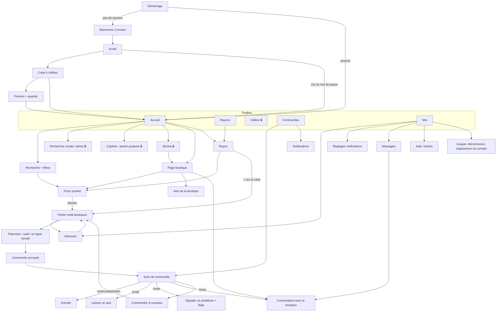
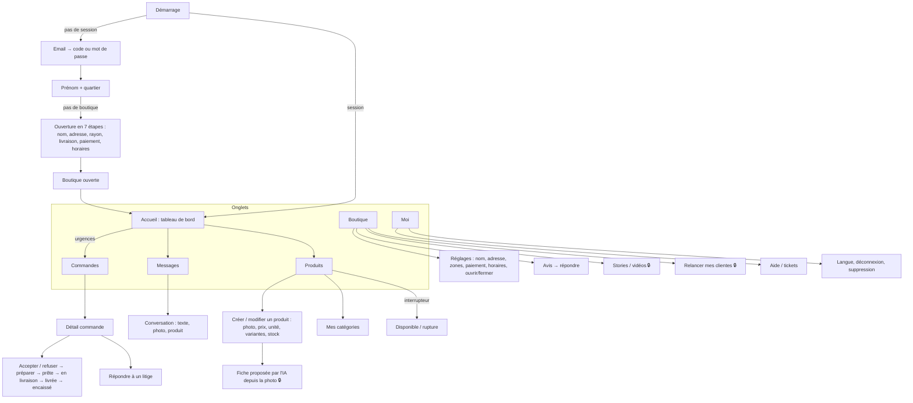
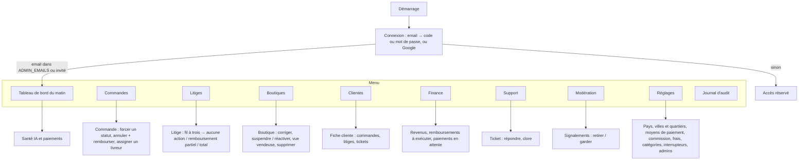

# Sitemap et flux des apps DYM

État du code sur `feat/023-pilot-test-setup` (2026-11-05). Les schémas sont en Mermaid (rendus par
GitHub). 🔒 = derrière un interrupteur (Admin → Réglages → Interrupteurs).

## DYM Cliente

## DYM Vendeuse

## DYM Admin

